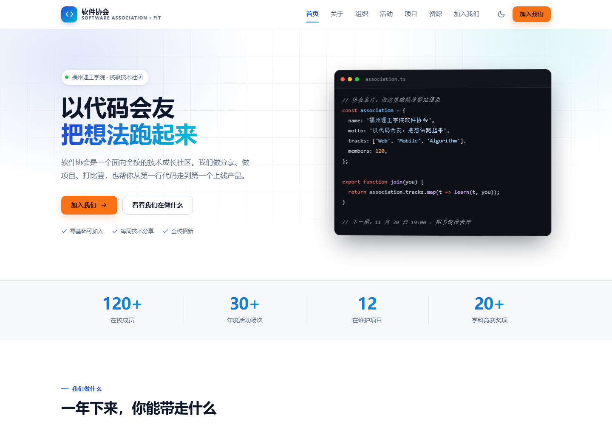

# 福州理工学院软件协会官网

面向全校的技术成长社区 · 协会官方网站



## 这是什么

一个**单文件静态站点**：`index.html` 里包含全部 HTML、CSS、JavaScript，没有构建步骤、没有 npm 依赖、没有 CDN 外链。双击就能打开，扔到任何静态服务器就能上线。

- 9 个页面：首页 / 关于我们 / 组织架构 / 活动与赛事 / 项目与成果 / 学习资源 / 加入我们 / 联系我们 / 404
- 亮色 / 暗色双主题，跟随系统并可手动切换，选择会记在 `localStorage`
- 响应式：手机 375px → 桌面 1440px+，兼容微信内置浏览器
- 无障碍：skip link、语义化标签、每页唯一 `h1`、键盘可达、`prefers-reduced-motion` 降级
- 无外部请求：图标全部内联 SVG，配图用 CSS 渐变与网格生成

## 本地预览

直接双击 `index.html`，或：

```bash
# 需要任意静态服务器，例如
python -m http.server 8080
# 然后访问 http://localhost:8080
```

站内使用哈希路由（`#/about`、`#/join`），**不需要服务器做 rewrite 配置**，部署在子目录也不会 404。

## 部署

**方式一 · GitHub Pages**

1. 仓库 Settings → Pages → Source 选 `Deploy from a branch`，分支选 `main` / 根目录
2. 等一两分钟，访问 `https://<用户名>.github.io/<仓库名>/`

> 注意：免费账户的 GitHub Pages **只对公开仓库生效**。私有仓库要开 Pages 需要 GitHub Pro。

**方式二 · 任意静态托管**（Vercel / Netlify / 校内 Nginx）

把 `index.html` 放到站点根目录即可。Nginx 不需要额外配置。

**方式三 · 校内服务器**

```bash
scp index.html user@server:/var/www/fit-sa/
```

## 怎么改内容

**所有文案都在 `index.html` 里同一处**：搜索 `const DATA = {`，往下能看到全部数据。

| 想改什么 | 改哪里 |
| --- | --- |
| 首页数据条（人数、活动场次） | `DATA.stats` |
| 协会简介、使命愿景、发展历程 | `DATA.about` |
| 部门、成员名单 | `DATA.team` |
| 活动列表 | `DATA.activities` |
| 项目、获奖记录 | `DATA.projects` / `DATA.awards` |
| 学习路线、课件下载 | `DATA.roadmaps` / `DATA.downloads` |
| 招新流程、FAQ、报名截止时间 | `DATA.join` |
| 邮箱、QQ 群、地址 | `DATA.contact` |
| 主题色、字号、圆角 | CSS 开头的 `:root` 设计令牌 |

改完保存、刷新浏览器就能看到，不需要编译。

**新增一场活动**：在 `DATA.activities` 数组里复制一段，改 `id`（不能重复）、`type`（必须是 `activityTypes` 里已有的类型）、`date`、`title`、`excerpt`、`detail` 即可，卡片、筛选、详情弹窗会自动生效。

## 上线前必须替换的内容

站内目前是**示例数据**，页脚已标注「演示版本」。正式使用前请逐条替换：

- [ ] `DATA.stats` 里的四个数字（`120` / `30` / `12` / `20`）
- [ ] `DATA.about.timeline` 里的 `20XX` 年份与事件
- [ ] `DATA.about.teacher` 的指导老师姓名与寄语
- [ ] `DATA.team` 全部成员姓名（现为「张同学」等占位）
- [ ] `DATA.activities` 的日期、地点、内容
- [ ] `DATA.projects` 的项目介绍与仓库链接
- [ ] `DATA.awards` 获奖记录
- [ ] `DATA.join.formUrl` 换成协会真实的报名表链接（现指向腾讯问卷首页）
- [ ] `DATA.join.qq` 招新群号（现为 `123456789`）
- [ ] `DATA.join.deadline` 报名截止时间
- [ ] `DATA.contact` 邮箱、公众号名、活动地点
- [ ] 页脚 ICP 备案号（现为 `闽ICP备XXXXXXXX号`）
- [ ] 校徽与照片：**使用前需获得校方及本人授权**

## 目录结构

```
.
├── index.html              # 整站（唯一必需文件）
├── README.md
├── docs/
│   └── AI建站提示词.md       # 生成这个站点用的提示词，可复用于改版
└── preview/
    ├── desktop-home.png
    └── mobile-home.png
```

## 浏览器支持

Chrome / Edge / Safari / Firefox 最近两个大版本，iOS Safari 15+，微信内置浏览器，QQ 浏览器。

## 许可

页面代码可自由修改使用；协会名称、校名、校徽等标识的使用需遵守福州理工学院相关规定。
